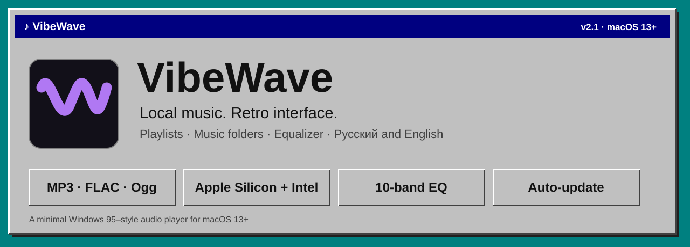
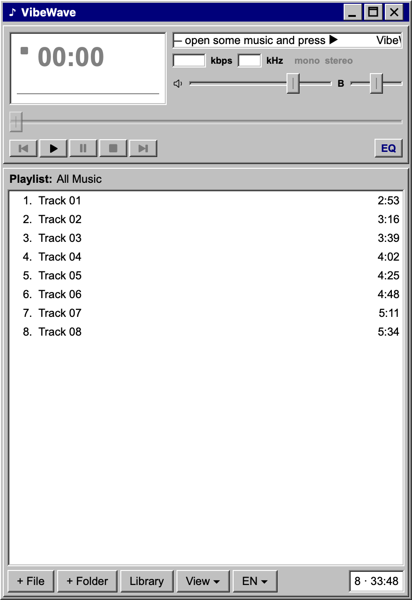
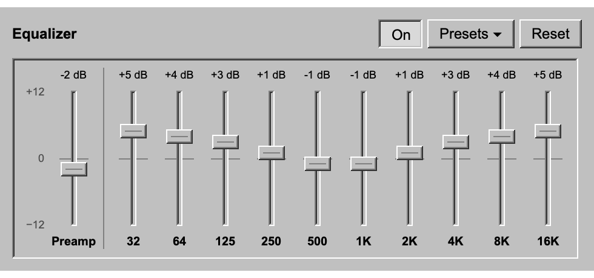
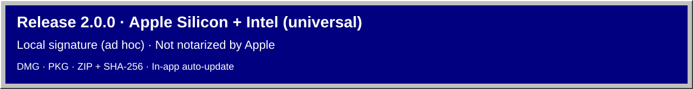

[Русский](README.md) · **English**



[](https://github.com/Slipcast-dev/VibeWave/releases/tag/v2.0.0)


[](https://github.com/Slipcast-dev/VibeWave/stargazers)
[](https://github.com/Slipcast-dev/VibeWave/releases)

# VibeWave

A lightweight local audio player for **macOS 13+** for MP3, FLAC, WAV, Wave64, AIFF, AAC, MPEG-4 Audio, CAF, and AU. Windows 95–style interface, 10-band equalizer, Russian and English, auto-update. No accounts and no third-party dependencies; the app connects to GitHub to check for and download updates.

[Download v2.0.0](https://github.com/Slipcast-dev/VibeWave/releases/tag/v2.0.0) · [Full documentation (Russian)](DOCUMENTATION.md) · [Changelog (Russian)](CHANGELOG.md) · [Development handoff (Russian)](HANDOFF.md) · [CI](https://github.com/Slipcast-dev/VibeWave/actions)

## Features

- Play, pause, stop, previous/next track, seeking, volume and balance.
- Shuffle, repeat queue, and repeat track. Change modes in the player, the Playback menu, or Settings (`⌘,`).
- Import and export M3U, M3U8, and PLS. Drop playlists into the player, or use relative paths to move a playlist with its music.
- MP3/FLAC tag and artwork editing, read-only MPEG-4 Audio tags, local star ratings, and configurable listening history.
- Section and library search, filters, sorting, and saved smart playlists.
- **Equalizer:** 10 bands (32 Hz – 16 kHz, ±12 dB), preamp and 9 presets; the **EQ** button sits to the right of the playback controls.
- Compact Windows 95–style player: time display, scrolling title, kbps/kHz and level meter, with the playlist below.
- “All Music”: playlists, folders and music outside playlists in one list, grouped by playlist or not.
- Music folders (including subfolders) with scan progress and cancel.
- Your own playback order by dragging rows; moving tracks between playlists.
- A temporary queue outside playlists: opening music never creates a playlist on its own.
- **Russian and English interface:** the language follows the system; the **RU ▾ / EN ▾** button switches it without a restart.
- One universal build for **Apple Silicon** and **Intel**.
- **Auto-update:** at launch VibeWave checks for a new version, asks “Update” or “Later”, downloads and installs it in the background and restarts when no music is playing.
- A custom retro window frame with working minimize, zoom and close buttons.

## Screenshots

<p>
  
</p>
<p>
  
</p>

Screenshots are rendered with test data, not a real music library.

## Installation



**[Release v2.0.0 and downloads](https://github.com/Slipcast-dev/VibeWave/releases/tag/v2.0.0)** are on GitHub. One build runs on **Apple Silicon (M1 and later)** and **Intel** Macs with macOS 13+.

- `VibeWave-2.0.0-macos-universal.dmg` — disk image: open it and drag VibeWave to Applications.
- `VibeWave-2.0.0-macos-universal.pkg` — installer that puts VibeWave in `/Applications`.
- `VibeWave-2.0.0-macos-universal.zip` — the app in a ZIP archive.
- `SHA256SUMS.txt` — checksums. Verify in the download folder: `shasum -a 256 -c SHA256SUMS.txt`.

The app has a local **ad hoc** signature and is not notarized by Apple. On first launch macOS shows a warning: allow it in System Settings → Privacy & Security. Do not turn off macOS protection entirely.

Versions before 2.0 cannot update themselves: install 2.0 manually once, and from then on VibeWave keeps itself up to date.

## Auto-update

- In **Settings → Updates**, turn launch checks on or off or select **Check Now**.
- If a compatible update is available, VibeWave offers **Update** or **Later**.
- After “Update” the archive downloads in the background and is verified: SHA-256, the developer’s Ed25519 signature, bundle identifier, version and code signature. A forged update is never installed.
- If nothing is playing, VibeWave replaces itself and restarts right away. If music is playing, it waits until playback stops; if you quit first, the new version is installed on quit.
- Updating works when VibeWave lives in Applications or another folder on disk; it is off when the app runs straight from the disk image. If you cannot write to the app’s folder, macOS asks for an administrator password.

The local stage 8 build is saved as `dist/VibeWave-Stage-8.app`. See the [handoff](HANDOFF.md) for acceptance results and hardware checks.

## Building from source

You need macOS 13+ and Swift 5.8 or later from Xcode or the Command Line Tools. From the project folder:

```sh
zsh scripts/build-app.sh
open dist/VibeWave.app
```

The script builds a **universal** app: the `arm64` (Apple Silicon) and `x86_64` (Intel) slices are combined in one `dist/VibeWave.app`. It picks SwiftPM or the plain compiler, generates the icon and verifies the ad hoc signature. For a quick build for the current Mac only: `VIBEWAVE_ARCHS="$(uname -m)" zsh scripts/build-app.sh`.

Installers from the finished build:

```sh
zsh scripts/package-release.sh
```

The DMG, PKG, ZIP, `SHA256SUMS.txt` and a signed `update.json` appear in `.release/v<version>-universal/`. `update.json` needs the update signing key `~/.config/vibewave/update-signing-key`, which is never stored in the repository. Installing without Gatekeeper warnings requires a Developer ID and Apple notarization. The local build runs without App Sandbox; macOS system protection stays on.

## Usage

1. Click **“+ File”** at the bottom left, or drop audio files onto the window.
2. To create a playlist, open **“Library”** and click **`+`** next to “Playlists”.
3. Select a playlist and add music to it. Drag a track from the queue onto a playlist, or choose **“Add to Playlist”** from the context menu.
4. **“Library”** shows All Music, playlists and folders. The **“View ▾”** menu switches between “Single List” and “By Playlist”. Add folders with **“+ Folder”** or by dragging them from Finder; while files are being added, progress and a **“Cancel”** button appear at the bottom right.
5. Drag a **track row** and drop it before another row, or in the empty area at the bottom to move it to the end. “Move Up/Move Down” are also in the context menu.
6. Click the time display to switch between elapsed and remaining time.
7. **EQ** at the right end of the ⏮ ▶ ❚❚ ■ ⏭ row opens the equalizer. Use “Presets → Manage Presets” to save your bands and preamp or transfer a preset as JSON.
8. **Settings → Audio** controls ReplayGain, gapless playback and crossfade. You can analyze the current view and separately confirm writing ReplayGain tags to MP3/FLAC files.
9. **RU ▾ / EN ▾** next to “View” chooses the language: “System”, “Русский” or “English”. By default VibeWave uses the macOS language: Russian if it comes before English in the language list, otherwise English.
10. The **Repeat** button cycles through off, queue, and track. The **Shuffle** button works independently.

**Keyboard shortcuts:** Space — play/pause; `⌘O` — add files; `⌘W` — close the window; `⌘M` — minimize; `⌘Q` — quit. Use **Settings → Shortcuts** to enable and assign global shortcuts or control system media keys. **General** offers paused queue restoration and an option to quit when closing the player window.

## Data

Playlists, folders and the manual All Music order are saved to:

```text
~/Library/Application Support/VibeWave/library.json
```

Audio files stay where they are: removing a track or playlist never deletes music from disk. The queue outside playlists lives in memory until you quit. The JSON is written atomically, and a damaged library is never silently overwritten. A library from the earlier “Тихо” app is read automatically and left unchanged.

View, language, equalizer and window settings are stored in the standard macOS preferences for `local.vibewave.player`.

## Checks

```sh
zsh scripts/check.sh
# With full Xcode installed:
swift test
```

Regression checks use a temporary library and test audio files and never touch your music or playlists. `VIBEWAVE_CHECK_ARCH=x86_64` checks the Intel slice on Apple Silicon through Rosetta.

The stars and downloads badges are refreshed with `zsh scripts/update-badges.sh`; the numbers are taken from GitHub when the script runs. Downloads count installers and updates, not `update.json` or `SHA256SUMS.txt`.

## Project layout

```text
Assets/                       source icon and its origin
Resources/Info.plist           app properties template
Sources/VibeWaveCore/          models, storage, file scanning, equalizer, RU/EN strings
Sources/VibeWave/              model, import, playback, window and interface
Tests/VibeWaveCoreTests/       XCTest for the core
Checks/                       integration checks and audio fixtures
scripts/                      build, checks, installers, badges
docs/                         architecture, testing, banners and screenshots
dist/VibeWave.app              built app, not tracked by Git
```

## Working with the repository

- [Contributing (Russian)](CONTRIBUTING.md)
- [Security (Russian)](SECURITY.md)
- [Code of conduct (Russian)](CODE_OF_CONDUCT.md)
- [Report a bug](https://github.com/Slipcast-dev/VibeWave/issues/new/choose)

GitHub Actions on an Intel macOS runner runs the core tests, the universal build, signature and slice checks, regression checks and installer packaging (nothing is published). Actions are pinned by SHA and the workflow can only read the source. Sound, gestures and Dock behavior are checked locally.

The repository is public: [Slipcast-dev/VibeWave](https://github.com/Slipcast-dev/VibeWave). No open-source license has been chosen yet: you can read the code, but no rights to use or modify it are granted.
