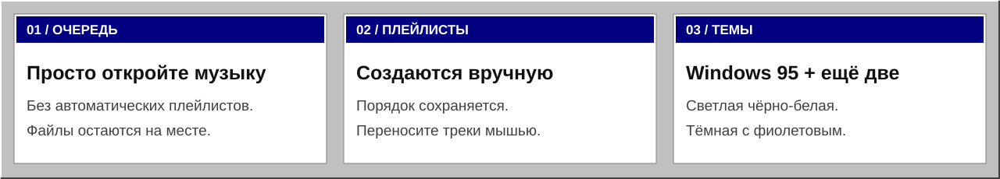

# VibeWave

Лёгкий локальный аудиоплеер для **macOS 13+**, MP3 и FLAC. Интерфейс в стиле Windows 95; без аккаунтов, сетевых функций и сторонних зависимостей.

[Скачать v0.6.0](https://github.com/Slipcast-dev/VibeWave/releases/tag/v0.6.0) · [Полная документация](DOCUMENTATION.md) · [Промт разработки](DEVELOPMENT_PROMPT.md) · [Изменения](CHANGELOG.md) · [CI](https://github.com/Slipcast-dev/VibeWave/actions)



## Полные документы

- [Полная документация в одном файле](DOCUMENTATION.md) — руководство, архитектура, сборка, проверки, данные и выпуск.
- [Промт разработки от идеи до релиза](DEVELOPMENT_PROMPT.md) — самостоятельное пошаговое задание для ИИ-разработчика.

## Возможности

- Воспроизведение, пауза, предыдущий/следующий трек, перемотка и громкость.
- Регулируемые столбцы с крупным форматом и временем, постоянный список музыки вне плейлистов.
- Собственный порядок перетаскиванием мышью и случайный режим без повторов в одном проходе.
- Три темы: Windows 95, светлая чёрно-белая и тёмная фиолетовая.
- Собственная ретро-рамка окна с рабочими кнопками сворачивания, разворачивания и закрытия. Заголовок можно перетаскивать; двойной щелчок разворачивает/восстанавливает окно.
- Временная очередь вне плейлистов. Открытие музыки не создаёт плейлист автоматически.
- Ручное создание, переименование и сохранение плейлистов.
- Перетаскивание файлов из Finder, перестановка треков и перенос между плейлистами.

## Запуск


**[Релиз v0.6.0 и файлы загрузки](https://github.com/Slipcast-dev/VibeWave/releases/tag/v0.6.0)** доступны участникам приватного репозитория.

- `VibeWave-0.6.0-macos-x86_64.zip` — готовое приложение для **macOS Intel**.
- `SHA256SUMS.txt` — контрольная сумма архива. Проверка в папке загрузки: `shasum -a 256 -c SHA256SUMS.txt`.
- Подпись локальная **ad hoc**, нотариализация Apple не выполнена. Проверенная arm64-сборка в этот релиз не включена.

Распакуйте архив и откройте `VibeWave.app`. Если macOS блокирует неподписанную Developer ID сборку, не отключайте защиту: используйте сборку из исходников либо дождитесь отдельной нотариализованной версии.

Локальный результат сборки находится в `dist/VibeWave.app`.

Из каталога проекта:

```sh
zsh scripts/build-app.sh
open dist/VibeWave.app
```

Нужны macOS 13+ и Swift 5.8 или новее из Xcode либо Command Line Tools. Скрипт автоматически выбирает SwiftPM или прямой компилятор, создаёт иконку и проверяет ad hoc подпись. Первая сборка системных модулей может занять несколько минут.

Сборка предназначена для архитектуры текущего компьютера. Для публичного распространения нужны отдельные сборки, Developer ID и notarization. Локальная версия работает без App Sandbox; системная защита macOS не отключается.

## Управление

1. Нажмите **«Добавить файлы…»** внизу слева или перетащите MP3/FLAC в окно.
2. Для создания плейлиста нажмите **`+`** рядом с заголовком «Плейлисты».
3. Выберите плейлист и добавьте туда музыку. Из очереди трек можно перетащить на плейлист либо выбрать **«Добавить в плейлист»** в контекстном меню.
4. Список **«Вне плейлистов»** виден слева даже при выбранном плейлисте. Кнопка списка рядом с ним показывает очередь в основной таблице.
5. Потяните **полоски слева от трека**: отпустите перед нужной строкой или в нижней области для переноса в конец. Также доступны «Выше/Ниже» в контекстном меню. Ручной перенос включает режим **«По списку»**.
6. Для ширины столбца потяните его правую границу в заголовке; двойной щелчок сбрасывает размер. Размеры сохраняются.
7. Меню **«Порядок»** переключает воспроизведение по списку и случайный режим.
8. Тема выбирается в нижнем меню **«Тема»** рядом с кнопкой добавления.

**Сочетания клавиш:** `⌘O` — добавить файлы в текущий раздел; `⌘W` — закрыть окно; `⌘M` — свернуть; `⌘Q` — завершить приложение. После закрытия окно открывается повторно нажатием на значок в Dock.

## Предпросмотр


Предпросмотр отрисован на тестовых данных, без пользовательской медиатеки.

## Данные

Плейлисты сохраняются в:

```text
~/Library/Application Support/VibeWave/library.json
```

Аудиофайлы остаются на исходном месте. Удаление трека или плейлиста не удаляет музыку с диска. Очередь вне плейлистов хранится в памяти до завершения приложения. Закрытие окна сохраняет процесс и очередь; `⌘Q` завершает приложение.

При первом запуске библиотека прежнего «Тихо» читается из `~/Library/Application Support/Tiho/library.json`, если новой библиотеки ещё нет. Старый файл не изменяется. Запись JSON атомарная; повреждённая библиотека не перезаписывается молча.

Настройки темы и положения окна хранятся в стандартных настройках macOS для `local.vibewave.player`. Очистка проекта и пересборка не удаляют пользовательскую библиотеку.

## Проверки

```sh
zsh scripts/check.sh
# При установленном полном Xcode:
swift test
```

Регрессионные проверки используют временную библиотеку и тестовые аудиофайлы. Они не изменяют музыку или плейлисты пользователя.

## Структура

```text
Assets/                       исходная иконка и её происхождение
Resources/Info.plist           шаблон свойств приложения
Sources/VibeWaveCore/          модели и хранилище
Sources/VibeWave/              интерфейс, окно и воспроизведение
Tests/VibeWaveCoreTests/       XCTest для ядра
Checks/                       интеграционные проверки и аудиофикстуры
scripts/                      сборка и проверки
VERSION                       версия приложения
CHANGELOG.md                  история изменений
docs/ARCHITECTURE.md           устройство проекта
docs/TESTING.md                автоматические и ручные проверки
dist/VibeWave.app              готовая сборка, исключённая из Git
```

`.build/`, `dist/`, Finder-метаданные и локальные настройки не включаются в Git. Репозиторий приватный: [Slipcast-dev/VibeWave](https://github.com/Slipcast-dev/VibeWave). Для разработки достаточно открыть `Package.swift` в Xcode либо работать с файлами напрямую.


## Работа с репозиторием

- [Участие в разработке](CONTRIBUTING.md)
- [Безопасность](SECURITY.md)
- [Правила взаимодействия](CODE_OF_CONDUCT.md)
- [Сообщить об ошибке](https://github.com/Slipcast-dev/VibeWave/issues/new/choose)

GitHub Actions выполняет сборку и тесты ядра на macOS Intel. Действия закреплены по SHA; права workflow ограничены чтением исходников. Звук, жесты и работа Dock проверяются локально.

Открытая лицензия пока не выбрана. Этот проект не объявлен open source.
