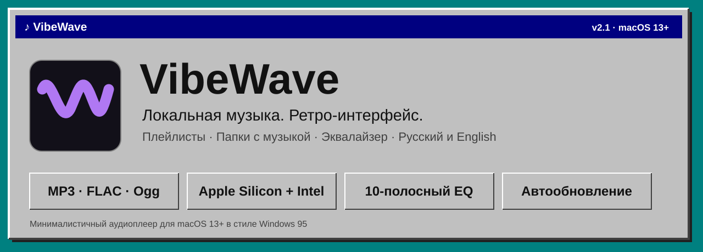
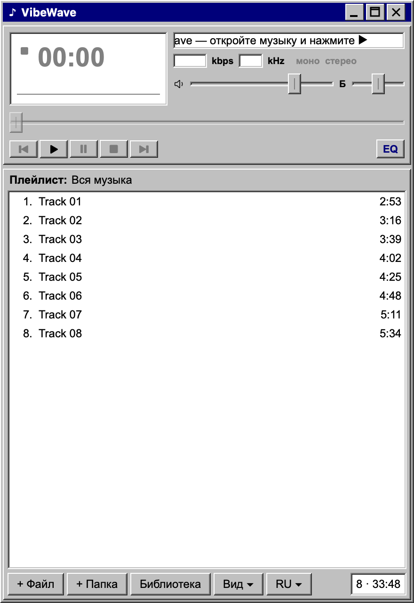
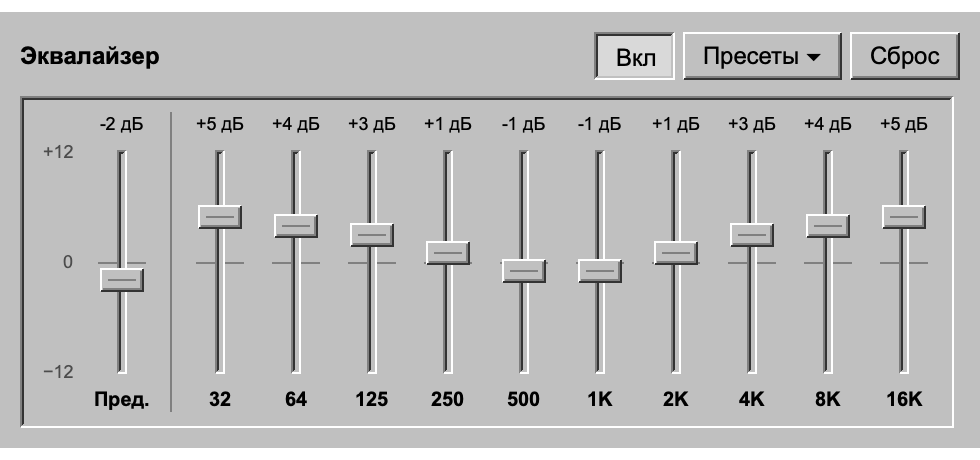
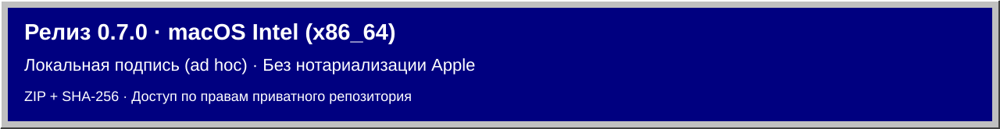

**Русский** · [English](README.en.md)



[](https://github.com/Slipcast-dev/VibeWave/releases/tag/v1.0.0)


[](https://github.com/Slipcast-dev/VibeWave/stargazers)
[](https://github.com/Slipcast-dev/VibeWave/releases)

# VibeWave

Лёгкий локальный аудиоплеер для **macOS 13+**, MP3 и FLAC. Интерфейс в стиле Windows 95, 10-полосный эквалайзер, русский и английский языки. Без аккаунтов, сетевых функций и сторонних зависимостей.

[Скачать v1.0.0](https://github.com/Slipcast-dev/VibeWave/releases/tag/v1.0.0) · [Полная документация](DOCUMENTATION.md) · [Промт разработки](DEVELOPMENT_PROMPT.md) · [Изменения](CHANGELOG.md) · [CI](https://github.com/Slipcast-dev/VibeWave/actions)

## Возможности

- Воспроизведение, пауза, стоп, предыдущий/следующий трек, перемотка, громкость и баланс.
- **Эквалайзер:** 10 полос (32 Гц – 16 кГц, ±12 дБ), предусиление и 9 пресетов; кнопка **EQ** справа от кнопок управления.
- Компактный плеер в стиле Windows 95: табло со временем, бегущая строка, kbps/kHz и индикатор уровня, плейлист под ним.
- Раздел «Вся музыка»: плейлисты, папки и музыка вне плейлистов в одном списке, с группировкой по плейлистам или без неё.
- Папки с музыкой (MP3 и FLAC, включая вложенные папки) с ходом сканирования и отменой.
- Собственный порядок воспроизведения перетаскиванием мышью, перенос треков между плейлистами.
- Временная очередь вне плейлистов: открытие музыки не создаёт плейлист автоматически.
- **Русский и английский интерфейс:** язык выбирается по языку системы, кнопка **RU ▾ / EN ▾** переключает его без перезапуска.
- Одна универсальная сборка для **Apple Silicon** и **Intel**.
- Собственная ретро-рамка окна с рабочими кнопками сворачивания, разворачивания и закрытия.

## Скриншоты

<p>
  
</p>
<p>
  
</p>

Скриншоты отрисованы на тестовых данных, без пользовательской медиатеки.

## Установка



**[Релиз v1.0.0 и файлы загрузки](https://github.com/Slipcast-dev/VibeWave/releases/tag/v1.0.0)** доступны участникам приватного репозитория. Одна сборка работает на **Apple Silicon (M1 и новее)** и на **Intel**, macOS 13+.

- `VibeWave-1.0.0-macos-universal.dmg` — образ диска: откройте и перетащите VibeWave в «Программы».
- `VibeWave-1.0.0-macos-universal.pkg` — мастер установки в `/Applications`.
- `VibeWave-1.0.0-macos-universal.zip` — архив приложения.
- `SHA256SUMS.txt` — контрольные суммы. Проверка в папке загрузки: `shasum -a 256 -c SHA256SUMS.txt`.

Подпись локальная **ad hoc**, нотариализация Apple не выполнена. При первом запуске macOS покажет предупреждение: разрешите открытие в «Системных настройках» → «Конфиденциальность и безопасность». Не отключайте защиту macOS целиком.

## Сборка из исходников

Нужны macOS 13+ и Swift 5.8 или новее из Xcode либо Command Line Tools. Из каталога проекта:

```sh
zsh scripts/build-app.sh
open dist/VibeWave.app
```

Скрипт собирает **универсальное** приложение: срезы `arm64` (Apple Silicon) и `x86_64` (Intel) объединяются в одном `dist/VibeWave.app`. Он сам выбирает SwiftPM или прямой компилятор, создаёт иконку и проверяет ad hoc подпись. Для быстрой отладки только под текущий Mac: `VIBEWAVE_ARCHS="$(uname -m)" zsh scripts/build-app.sh`.

Установщики из готовой сборки:

```sh
zsh scripts/package-release.sh
```

DMG, PKG, ZIP и `SHA256SUMS.txt` появляются в `.release/v<версия>-universal/`. Для установки без предупреждений Gatekeeper нужны Developer ID и нотариализация Apple. Локальная версия работает без App Sandbox; системная защита macOS не отключается.

## Управление

1. Нажмите **«+ Файл»** внизу слева или перетащите MP3/FLAC в окно.
2. Для создания плейлиста откройте **«Библиотека»** и нажмите **`+`** рядом с заголовком «Плейлисты».
3. Выберите плейлист и добавьте туда музыку. Из очереди трек можно перетащить на плейлист либо выбрать **«Добавить в плейлист»** в контекстном меню.
4. **«Библиотека»** открывает «Вся музыка», плейлисты и папки. Меню **«Вид ▾»** переключает «Общий список» и «По плейлистам». Папки добавляются кнопкой **«+ Папка»** или перетаскиванием из Finder; пока идёт добавление, справа внизу видны его ход и кнопка **«Отмена»**.
5. Потяните **строку трека** мышью: отпустите перед нужной строкой или в нижней области для переноса в конец. Также доступны «Выше/Ниже» в контекстном меню.
6. Щелчок по времени на табло переключает прошедшее и оставшееся время.
7. **EQ** у правого края ряда ⏮ ▶ ❚❚ ■ ⏭ открывает эквалайзер: полосы, предусиление, «Вкл», «Пресеты ▾» и «Сброс». Изменения слышны сразу и сохраняются.
8. **RU ▾ / EN ▾** справа от «Вид» выбирает язык: «Как в системе», «Русский» или «English». По умолчанию — язык macOS: русский, если он стоит в списке языков раньше английского, иначе английский.

**Сочетания клавиш:** пробел — воспроизведение/пауза; `⌘O` — добавить файлы; `⌘W` — закрыть окно; `⌘M` — свернуть; `⌘Q` — завершить приложение. После закрытия окно открывается повторно нажатием на значок в Dock.

## Данные

Плейлисты, папки и ручной порядок раздела «Вся музыка» сохраняются в:

```text
~/Library/Application Support/VibeWave/library.json
```

Аудиофайлы остаются на исходном месте: удаление трека или плейлиста не удаляет музыку с диска. Очередь вне плейлистов хранится в памяти до завершения приложения. Запись JSON атомарная; повреждённая библиотека не перезаписывается молча. Библиотека прежнего «Тихо» читается автоматически, старый файл не изменяется.

Настройки вида, языка, эквалайзера и положения окна хранятся в стандартных настройках macOS для `local.vibewave.player`.

## Проверки

```sh
zsh scripts/check.sh
# При установленном полном Xcode:
swift test
```

Регрессионные проверки используют временную библиотеку и тестовые аудиофайлы и не изменяют музыку или плейлисты пользователя. `VIBEWAVE_CHECK_ARCH=x86_64` проверяет Intel-срез на Apple Silicon через Rosetta.

Значки звёзд и скачиваний обновляются командой `zsh scripts/update-badges.sh`. Репозиторий приватный, поэтому внешние сервисы значков его не видят: числа фиксируются в момент запуска скрипта.

## Структура

```text
Assets/                       исходная иконка и её происхождение
Resources/Info.plist           шаблон свойств приложения
Sources/VibeWaveCore/          модели, хранилище, поиск файлов, эквалайзер, строки RU/EN
Sources/VibeWave/              модель, импорт, воспроизведение, окно и интерфейс
Tests/VibeWaveCoreTests/       XCTest для ядра
Checks/                       интеграционные проверки и аудиофикстуры
scripts/                      сборка, проверки, установщики, значки
docs/                         архитектура, проверки, баннеры и скриншоты
dist/VibeWave.app              готовая сборка, исключённая из Git
```

## Работа с репозиторием

- [Участие в разработке](CONTRIBUTING.md)
- [Безопасность](SECURITY.md)
- [Правила взаимодействия](CODE_OF_CONDUCT.md)
- [Сообщить об ошибке](https://github.com/Slipcast-dev/VibeWave/issues/new/choose)

GitHub Actions на macOS Intel выполняет тесты ядра, универсальную сборку, проверку подписи и обоих срезов, регрессионные проверки и сборку установщиков (без публикации). Действия закреплены по SHA; права workflow ограничены чтением исходников. Звук, жесты и работа Dock проверяются локально.

Открытая лицензия пока не выбрана. Этот проект не объявлен open source. Репозиторий приватный: [Slipcast-dev/VibeWave](https://github.com/Slipcast-dev/VibeWave).
